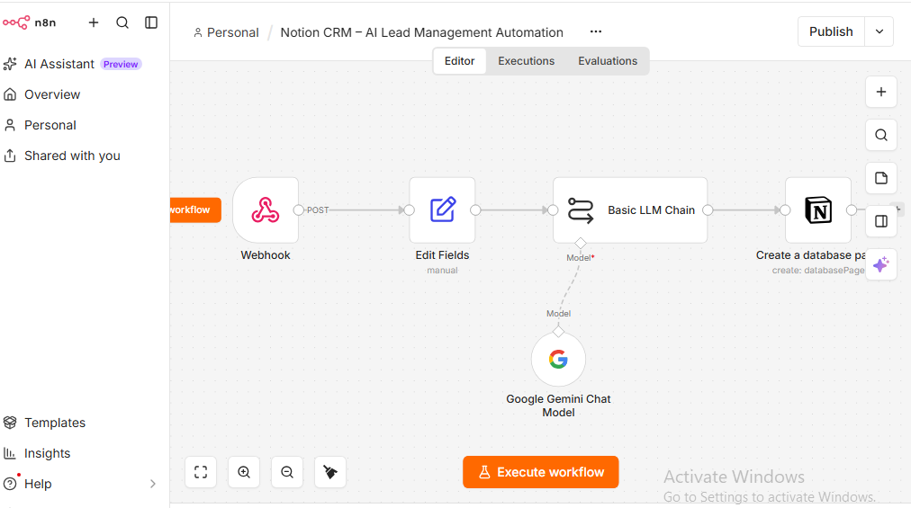

# 📊 AI Lead Management CRM

An AI automation project designed to help businesses organize, process, and manage leads through an automated workflow.

The system demonstrates how AI and workflow automation can be combined to reduce repetitive lead-management tasks and create a more organized sales process.

---

## 🎯 Project Overview

Managing leads manually can become difficult as the number of inquiries increases.

Businesses may need to:

- Collect lead information
- Organize customer details
- Process incoming lead data
- Identify important leads
- Store lead information
- Keep CRM records organized
- Trigger follow-up actions

This project demonstrates an automated approach to lead management using **n8n and AI-powered workflow automation**.

---

## 💡 Solution

The workflow automates the lead-management process so that incoming lead information can be processed and organized automatically.

### High-Level Architecture

```text
Lead / Customer
       ↓
Lead Information
       ↓
n8n Automation
       ↓
AI Processing
       ↓
Lead Management
       ↓
CRM / Data Storage
       ↓
Follow-Up / Business Action
```

---

## ⚙️ Automation Workflow

The overall automation follows a structured process:

### 1. Lead Capture

The workflow receives incoming lead information from the connected source.

### 2. Data Processing

Lead information is processed and organized into structured fields.

### 3. AI Processing

AI can be used to analyze lead information and help determine how the lead should be handled.

### 4. Lead Management

Processed lead information is stored and organized for easier management.

### 5. Business Action

The workflow can trigger the next appropriate action based on the processed lead information.

---

## 🤖 AI Automation

The AI component can help transform unstructured lead information into useful business data.

Possible AI-assisted tasks include:

- Lead analysis
- Information extraction
- Lead qualification
- Lead categorization
- Priority assessment
- Follow-up recommendations

> The exact AI fields and rules shown in the implementation depend on the workflow configuration used in the project.

---

## 🔄 Workflow Concept

```text
┌─────────────────┐
│  Lead Source    │
└────────┬────────┘
         ↓
┌─────────────────┐
│  n8n Workflow   │
└────────┬────────┘
         ↓
┌─────────────────┐
│ Data Processing │
└────────┬────────┘
         ↓
┌─────────────────┐
│  AI Processing  │
└────────┬────────┘
         ↓
┌─────────────────┐
│ Lead Management │
└────────┬────────┘
         ↓
┌─────────────────┐
│ CRM / Database  │
└────────┬────────┘
         ↓
┌─────────────────┐
│ Business Action │
└─────────────────┘
```

---

# 🛠️ Technologies

### Automation

- n8n
- Workflow Automation
- Webhooks / APIs
- JSON

### AI

- AI-powered data processing
- Large Language Models
- Prompt Engineering
- Structured AI Output

### Business Automation

- Lead Management
- CRM Automation
- Data Processing
- Follow-Up Automation

---

# 📸 Project Screenshots

Screenshots demonstrating the actual implementation will be added here.

### Workflow Overview
1. Complete workflow overview of crm lead management system.


### Lead Processing


### CRM / Lead Data


---

# 📈 Business Benefits

An automated lead-management workflow can help businesses:

- Reduce repetitive manual work
- Organize incoming leads
- Process lead information consistently
- Improve lead visibility
- Support faster follow-up
- Create a more structured sales process
- Connect different business tools through automation

---

# 🎓 What This Project Demonstrates

This project demonstrates practical experience with:

- n8n workflow design
- AI automation
- Business process automation
- CRM workflows
- Structured data processing
- API-based integrations
- AI-assisted decision making
- Automation architecture

---

# 🚀 Possible Extensions

The system can be extended with additional business functionality such as:

- Automated email follow-ups
- WhatsApp lead notifications
- Lead scoring
- Sales-team notifications
- Calendar booking
- CRM synchronization
- Lead nurturing sequences
- Analytics dashboards
- Human approval steps

---

# 💼 Need a Similar Automation?

I build custom AI-powered automation systems using n8n for businesses.

I can help automate:

- Lead management
- CRM processes
- Customer communication
- Email workflows
- WhatsApp automation
- AI agents
- Business APIs
- Repetitive administrative tasks

### Let's automate your business.

📩 **Available for freelance AI automation projects.**

---

## 👨‍💻 Developer

**Syed Ali Abbas**

AI Automation Developer | n8n Specialist

Building practical AI-powered automation systems for real business workflows.

---

⭐ If you're interested in a similar automation system, feel free to get in touch.
