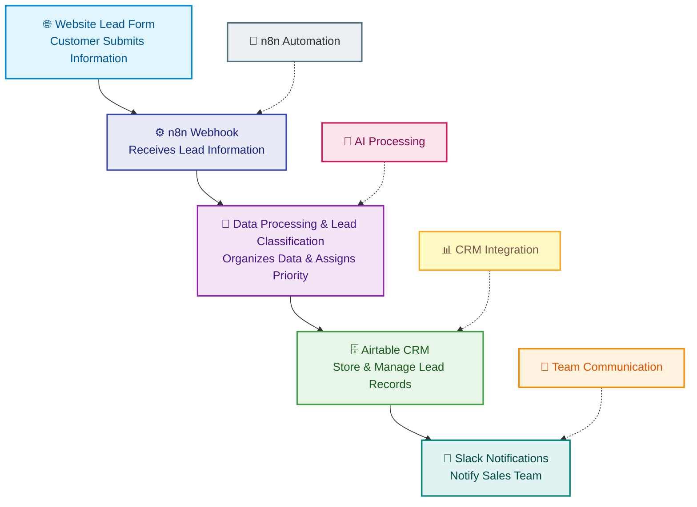
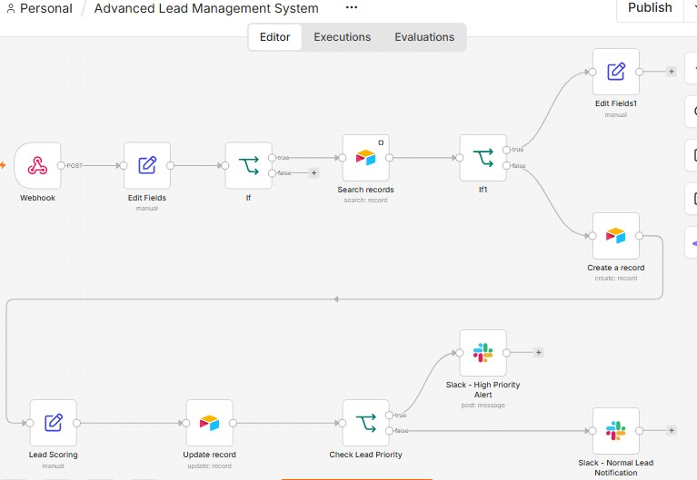

# AI Lead Management CRM**

## Project Overview

I developed an automated Lead Management CRM using n8n, Airtable, and Slack. This system helps businesses capture, organize, prioritize, and manage incoming customer leads automatically.

---

## Business Problem

Businesses often receive leads through website forms and manually enter customer information into spreadsheets or CRM systems.

This process can cause:

- Delayed responses to potential customers.
- Manual data entry.
- Poor lead organization.
- Missed business opportunities.

---

## Workflow Architecture

I built an n8n workflow that automates the lead management process.

### Workflow Process

My CRM automation is divided into two main stages.

### Stage 1: Lead Capture and Database Management

1. Webhook receives customer information.
2. Edit Fields organizes incoming data.
3. IF node evaluates the lead-processing condition.
4. Airtable Search Records checks whether the lead already exists.
5. IF node determines whether to create or handle an existing record.
6. Airtable Create Record stores new lead information.

### Stage 2: Lead Scoring and Notifications

1. Lead Scoring processes the lead information.
2. Airtable Update Record updates the lead record.
3. Check Lead Priority evaluates the assigned priority.
4. High-priority leads trigger a dedicated Slack notification.
5. Normal-priority leads trigger a standard Slack notification.

### Automation Benefits

- Centralized lead management.
- Duplicate lead checking.
- Automated lead scoring.
- Priority-based notifications.
- Less manual data entry.

---

## Key Features

- Automated lead capture.
- Customer information management.
- Lead priority classification.
- Airtable CRM integration.
- Slack notifications.
- Reduced manual data entry.

## Technologies Used

- n8n – Workflow automation
- Airtable – Lead database
- Slack – Team notifications
- Webhooks – Data collection

---

## Workflow Screenshots

!***Complete n8n Advanced Lead Management CRM Workflow.***

---

!***Successful Workflow Execution – Lead Capture and Processing.***
.png)

---

!***Webhook incoming data into webhook node.***
.png)

---

!***Customer lead data saved to airtable.***
.png)

---

!***Slack lead notification send to slack team.***
.png)

---

## Results

The workflow successfully captures test leads, stores their information in Airtable, and sends Slack notifications.

---

## Project Type

Personal Automation Project / Portfolio Demonstration

## Skills Demonstrated

n8n Workflow Automation | Webhooks | Airtable Integration | Slack Integration | Data Processing
