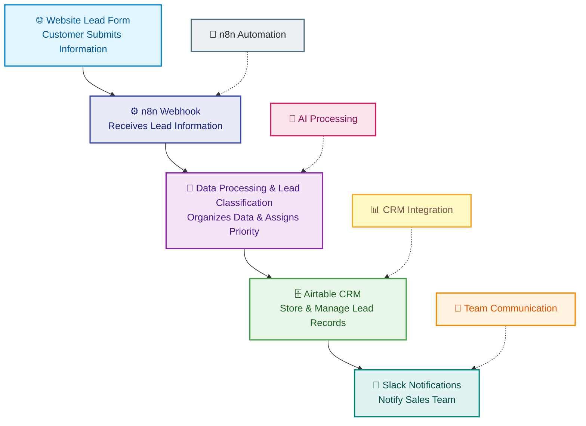

  

# 📘 N8N Lead Management CRM

## 🎯 Project Overview

I developed an automated Lead Management CRM using n8n, Airtable, and Slack.

The system receives customer information through a website form, processes incoming lead data, checks existing CRM records, manages lead information, assigns priorities, and sends notifications to the sales team.

The main objective is to help businesses manage incoming leads efficiently without relying on repetitive manual work.

---
## 📚 Project Documentation

For a detailed explanation of the workflow architecture, individual nodes, configuration, and business applications, read the complete project walkthrough:

📖 **[Read the Complete Project Walkthrough](docs/PROJECT-WALKTHROUGH.md)**

---

## ⚠️ Business Problem

Businesses often receive leads through website forms and manually enter customer information into spreadsheets or CRM systems.

This process can create several challenges:

- Delayed responses to potential customers.
- Repetitive manual data entry.
- Poor lead organization.
- Duplicate customer records.
- Difficulty identifying high-priority leads.
- Missed business opportunities.

---

## 💡 Solution

I developed an n8n automation workflow that connects a website lead form with Airtable CRM and Slack.

The automation handles:

- Incoming lead collection.
- Customer data processing.
- Duplicate lead checking.
- Lead scoring and priority classification.
- CRM record creation and updating.
- Priority-based Slack notifications.

---

## 🏗️ Workflow Architecture

The system follows this architecture:

---

## ⚙️ Workflow Process

The automation is divided into two main stages.

### Stage 1: Lead Capture & Database Management

1. **Webhook:** Receives incoming customer information from the website lead form.
2. **Edit Fields:** Organizes and prepares the incoming lead data.
3. **IF Node:** Evaluates the lead-processing condition.
4. **Airtable Search Records:** Checks whether the lead already exists in the CRM.
5. **IF Node:** Determines how to handle new and existing records.
6. **Airtable Create Record:** Stores new lead information in Airtable.

### Stage 2: Lead Scoring & Notifications

1. **Lead Scoring:** Processes lead information and assigns a priority.
2. **Airtable Update Record:** Updates the CRM record with the scoring information.
3. **Check Lead Priority:** Evaluates the assigned lead priority.
4. **High Priority Notification:** Sends a dedicated Slack notification for high-priority leads.
5. **Standard Notification:** Sends a standard Slack notification for normal-priority leads.

---

## ✨ Key Features

- 🌐 Automated website lead capture.
- 📝 Customer information processing.
- 🔍 Duplicate lead detection.
- 📊 Automated lead scoring.
- 🚦 Lead priority classification.
- 🗄️ Airtable CRM integration.
- 💬 Slack team notifications.
- ⚡ Reduced manual data entry.

---

## 🛠️ Technologies Used

| Technology | Purpose |
|---|---|
| n8n | Workflow automation |
| Airtable | Lead database and CRM |
| Slack | Sales team notifications |
| Webhooks | Incoming lead collection |
| JSON | Structured data processing |

---

## 📸 Workflow Screenshots

### 1. Complete n8n Workflow

The complete Lead Management CRM automation, showing the connected workflow stages.

### 2. Successful Workflow Execution

Demonstration of successful lead capture and processing.

.png)

### 3. Webhook Incoming Data

Incoming customer information received through the n8n Webhook node.

.png)

### 4. Airtable CRM Record

Customer lead information successfully stored in Airtable.

.png)

### 5. Slack Notification

Lead notification successfully delivered to the Slack team.

.png)

---

## 📊 Results

The workflow was successfully tested and demonstrated the following:

- Incoming test leads were received through the webhook.
- Customer information was processed.
- Lead records were stored in Airtable.
- Lead priority was evaluated.
- Slack notifications were sent according to lead priority.

The project demonstrates an automated process for managing incoming business leads.

---

## 💼 Business Benefits

This automation can help businesses:

- Reduce repetitive manual data entry.
- Keep customer information organized.
- Identify important leads more efficiently.
- Improve sales team visibility.
- Reduce the risk of missed leads.
- Centralize lead information in Airtable.

---

## 📌 Project Information

| Detail | Description |
|---|---|
| Project Name | AI Lead Management CRM |
| Project Type | Personal Automation Project |
| Automation Platform | n8n |
| CRM Database | Airtable |
| Notification Platform | Slack |
| Project Status | Completed |
| Demonstration | Test workflow execution |

---

## 🚀 Need a Similar Automation?

I can help businesses build custom automation systems for:

- Lead capture and management.
- CRM automation.
- Automated lead qualification.
- Sales team notifications.
- Business process automation.
- API and application integrations.

**Let's automate your business processes!**

👨‍💻 **Developer:** Syed Ali Abbas

🔗 **GitHub:** [github.com/syedaliabbashamdani](https://github.com/syedaliabbashamdani)

